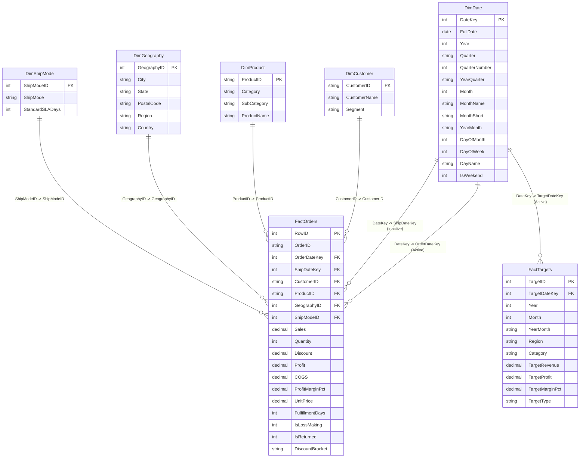

# POWER BI TABULAR DATA MODEL & STAR-SCHEMA ARCHITECTURE
## Business Performance Diagnosis & Decision Intelligence Platform

**Model Architecture:** Kimball Star Schema (Dual-Fact Enterprise Model)  
**Target BI Application:** Microsoft Power BI Desktop (Windows 11 Compatible)  
**Primary Engine:** Microsoft VertiPaq Tabular In-Memory Storage Engine  
**Governance Status:** 100% Reconciled with SQLite Warehouse & Python Analytics Engine  

---

## 1. CONCEPTUAL & LOGICAL STAR SCHEMA MODEL



---

## 2. TABLE SPECIFICATIONS, GRAIN & RECORD COUNTS

| Table Name | Schema Role | Table Grain | Row Count | Primary Key | Foreign Keys / Linkages |
| :--- | :--- | :--- | :---: | :--- | :--- |
| **`FactOrders`** | Transaction Fact | One record per individual order line item | **9,994** | `RowID` (Integer) | `OrderDateKey`, `ShipDateKey`, `CustomerID`, `ProductID`, `GeographyID`, `ShipModeID` |
| **`FactTargets`** | Budget Fact | One record per calendar month $\times$ Region $\times$ Category | **576** | `TargetID` (Integer) | `TargetDateKey` $\rightarrow$ `DimDate[DateKey]` *(Synthetic targets)* |
| **`DimDate`** | Conformed Dimension | One record per continuous calendar day (2015-01-01 to 2019-12-31) | **1,826** | `DateKey` (Integer: YYYYMMDD) | None (Marked as Official Date Table in Power BI) |
| **`DimCustomer`** | Dimension | One record per unique customer account | **793** | `CustomerID` (String) | None |
| **`DimProduct`** | Dimension | One record per unique product SKU | **1,862** | `ProductID` (String) | None |
| **`DimGeography`** | Dimension | One record per unique City/State/PostalCode combination | **632** | `GeographyID` (Integer) | None |
| **`DimShipMode`** | Dimension | One record per shipping fulfillment class | **4** | `ShipModeID` (Integer) | None |

---

## 3. RELATIONSHIP MATRIX & FILTER DIRECTIONS

In enterprise Power BI tabular modeling, **single-direction cross-filtering (1 $\rightarrow$ $\infty$) from Dimension to Fact** is the strict industry best practice.

| From Table (Dimension) | From Key | To Table (Fact) | To Key | Cardinality | Cross-Filter Direction | Relationship Status | Rationale |
| :--- | :--- | :--- | :--- | :---: | :---: | :---: | :--- |
| **`DimDate`** | `DateKey` | **`FactOrders`** | `OrderDateKey` | $1 \rightarrow \infty$ | **Single** | **Active** | Standard time slicing for sales, revenue, profit, and order volumes. |
| **`DimDate`** | `DateKey` | **`FactOrders`** | `ShipDateKey` | $1 \rightarrow \infty$ | **Single** | *Inactive* | Secondary role-playing relationship activated via DAX: `USERELATIONSHIP(FactOrders[ShipDateKey], DimDate[DateKey])`. |
| **`DimDate`** | `DateKey` | **`FactTargets`** | `TargetDateKey` | $1 \rightarrow \infty$ | **Single** | **Active** | Connects monthly synthetic planning targets to the calendar dimension. |
| **`DimCustomer`** | `CustomerID` | **`FactOrders`** | `CustomerID` | $1 \rightarrow \infty$ | **Single** | **Active** | Slices transaction volume and margin by customer account and commercial segment. |
| **`DimProduct`** | `ProductID` | **`FactOrders`** | `ProductID` | $1 \rightarrow \infty$ | **Single** | **Active** | Propagates product hierarchy: Category $\rightarrow$ Sub-Category $\rightarrow$ SKU. |
| **`DimGeography`**| `GeographyID` | **`FactOrders`** | `GeographyID` | $1 \rightarrow \infty$ | **Single** | **Active** | Propagates geographic hierarchy: Country $\rightarrow$ Region $\rightarrow$ State $\rightarrow$ City. |
| **`DimShipMode`** | `ShipModeID` | **`FactOrders`** | `ShipModeID` | $1 \rightarrow \infty$ | **Single** | **Active** | Filters orders by carrier mode and evaluates actual cycle days vs. SLA. |

> [!IMPORTANT]
> **WHY BI-DIRECTIONAL FILTERING IS STRICTLY AVOIDED:**  
> Enabling bi-directional cross-filtering creates ambiguous filter paths in multi-fact schemas (FactOrders $\leftrightarrow$ DimDate $\leftrightarrow$ FactTargets). This causes severe VertiPaq performance degradation and produces incorrect subtotals. In this platform, cross-fact comparisons are achieved cleanly through explicit DAX measures without touching relationship filter directions.

---

## 4. HANDLING SYNTHETIC PLANNING TARGETS IN POWER BI

`FactTargets` is modeled at a monthly aggregate grain by `Region` and `Category`, whereas `FactOrders` is at a granular transaction line grain.

To analyze Actuals vs. Targets seamlessly:
1. Both facts share `DimDate` as a conformed calendar dimension via `DateKey` (Year and Month levels).
2. For Category and Region slicing, DAX measures retrieve the current filter context of `DimProduct[Category]` and `DimGeography[Region]` using `TREATAS` or native context filtering:
   ```dax
   Target Revenue = 
   CALCULATE(
       SUM(FactTargets[TargetRevenue]),
       TREATAS(VALUES(DimGeography[Region]), FactTargets[Region]),
       TREATAS(VALUES(DimProduct[Category]), FactTargets[Category])
   )
   ```
3. This guarantees that when a user clicks "Central" on the report slicer, both `[Total Sales]` (from `FactOrders`) and `[Target Revenue]` (from `FactTargets`) update simultaneously and accurately.

---

## 5. POWER QUERY M TRANSFORMATION CODE

When loading CSV files in Power BI Desktop (Home $\rightarrow$ Get Data $\rightarrow$ Text/CSV), apply the following Power Query (M) transformations to enforce correct schema data types:

### 5.1 Power Query M: `FactOrders`
```powerquery
let
    Source = Csv.Document(File.Contents("C:\Users\ankit\OneDrive\Desktop\Business performance diagnosis\data\processed\fact_orders.csv"),[Delimiter=",", Columns=19, Encoding=1252, QuoteStyle=QuoteStyle.None]),
    #"Promoted Headers" = Table.PromoteHeaders(Source, [PromoteAllScalars=true]),
    #"Changed Type" = Table.TransformColumnTypes(#"Promoted Headers",{
        {"RowID", Int64.Type},
        {"OrderID", type text},
        {"OrderDateKey", Int64.Type},
        {"ShipDateKey", Int64.Type},
        {"CustomerID", type text},
        {"ProductID", type text},
        {"GeographyID", Int64.Type},
        {"ShipModeID", Int64.Type},
        {"Sales", type number},
        {"Quantity", Int64.Type},
        {"Discount", type number},
        {"Profit", type number},
        {"COGS", type number},
        {"ProfitMarginPct", type number},
        {"UnitPrice", type number},
        {"FulfillmentDays", Int64.Type},
        {"IsLossMaking", Int64.Type},
        {"IsReturned", Int64.Type},
        {"DiscountBracket", type text}
    })
in
    #"Changed Type"
```

### 5.2 Power Query M: `DimDate`
```powerquery
let
    Source = Csv.Document(File.Contents("C:\Users\ankit\OneDrive\Desktop\Business performance diagnosis\data\processed\dim_date.csv"),[Delimiter=",", Columns=14, Encoding=1252, QuoteStyle=QuoteStyle.None]),
    #"Promoted Headers" = Table.PromoteHeaders(Source, [PromoteAllScalars=true]),
    #"Changed Type" = Table.TransformColumnTypes(#"Promoted Headers",{
        {"DateKey", Int64.Type},
        {"FullDate", type date},
        {"Year", Int64.Type},
        {"Quarter", type text},
        {"QuarterNumber", Int64.Type},
        {"YearQuarter", type text},
        {"Month", Int64.Type},
        {"MonthName", type text},
        {"MonthShort", type text},
        {"YearMonth", type text},
        {"DayOfMonth", Int64.Type},
        {"DayOfWeek", Int64.Type},
        {"DayName", type text},
        {"IsWeekend", Int64.Type}
    })
in
    #"Changed Type"
```

### 5.3 Power Query M: `FactTargets`
```powerquery
let
    Source = Csv.Document(File.Contents("C:\Users\ankit\OneDrive\Desktop\Business performance diagnosis\data\processed\fact_targets.csv"),[Delimiter=",", Columns=11, Encoding=1252, QuoteStyle=QuoteStyle.None]),
    #"Promoted Headers" = Table.PromoteHeaders(Source, [PromoteAllScalars=true]),
    #"Changed Type" = Table.TransformColumnTypes(#"Promoted Headers",{
        {"TargetID", Int64.Type},
        {"TargetDateKey", Int64.Type},
        {"Year", Int64.Type},
        {"Month", Int64.Type},
        {"YearMonth", type text},
        {"Region", type text},
        {"Category", type text},
        {"TargetRevenue", type number},
        {"TargetProfit", type number},
        {"TargetMarginPct", type number},
        {"TargetType", type text}
    })
in
    #"Changed Type"
```

---

## 6. DATE TABLE CONFIGURATION & SORTING CONVENTIONS

In Power BI Desktop:
1. Select table `DimDate` $\rightarrow$ Right-click $\rightarrow$ **Mark as Date Table** $\rightarrow$ Select `FullDate` as the date column.
2. Sort Columns by Order:
   - Sort `MonthName` by column `Month`.
   - Sort `MonthShort` by column `Month`.
   - Sort `YearQuarter` by column `DateKey` (or Year & QuarterNumber).
   - Sort `YearMonth` by column `DateKey`.
   - Sort `DayName` by column `DayOfWeek`.
